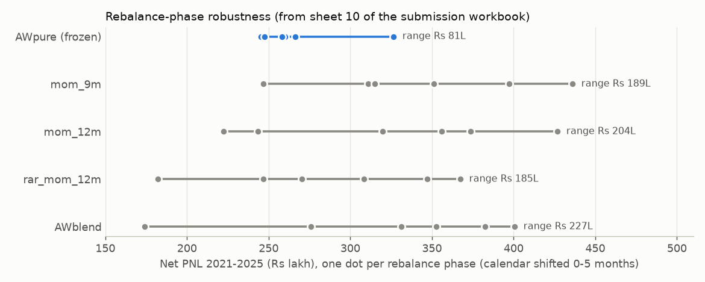
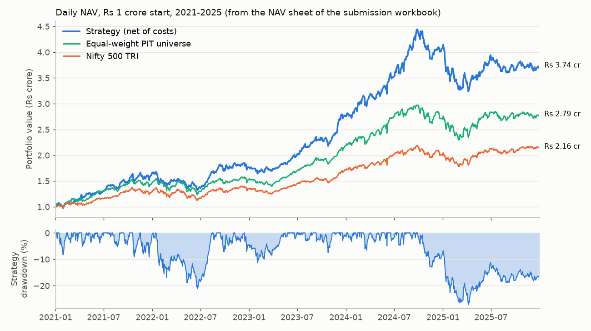

# Finesse × Citadel Stock Pitch — Round 2

A systematic, point-in-time-honest equity backtest for the Indian market, built for the Finesse × Citadel stock-pitch competition (Team Avocado, IIT Bombay).

## What it is

Round 2 of the competition asked for a rules-based stock strategy under a fixed mandate:

- ₹1,00,00,000 corpus, **at most 10 stocks**, long-only
- universe restricted to **Nifty 100 + Nifty Midcap 100 + Nifty Smallcap 100**
- backtest 1 Jan 2021 – 31 Dec 2025, then an out-of-sample stress window 1 Jan – 30 Jun 2026
- 0.1% transaction cost per side, ranked on Total Net PNL (plus rationale, robustness and risk management)

The deliverable is [`FINESSE_CITADEL_SUBMISSION.xlsx`](FINESSE_CITADEL_SUBMISSION.xlsx) — 10 sheets, 7,329 live Excel formulas, 0 broken references — plus the code that produces every number in it.

## What I did

**1. Built a point-in-time universe instead of using today's index lists.** NSE doesn't publish free historical constituents, so at each month-end I rank the traded universe by market cap (price × shares outstanding as of that date), apply listing/trading-status filters, and assign rank bands to the three index sleeves. It's directionally right rather than exact, and flagged as an assumption in [`ASSUMPTIONS.md`](ASSUMPTIONS.md).

To see why this matters I ran the *same* baseline 12-month momentum strategy on both universes (`survivorship_exhibit.py`): today's lists give ₹5.58 cr final value vs ₹4.19 cr on the PIT universe — **PNL inflated by 43.7%, CAGR by 7.88pp a year**, while drawdown barely moves (−33.61% vs −32.65%). Survivorship flatters return, not risk, which is exactly why it's easy to miss.

**2. Cleaned the data against the official record.** Yahoo Finance prices were cross-checked against NSE bhavcopies. That caught corrupt adjusted series (CYBERTECH printing +9411% then −99.1% three days later). One uniform rule excluded 32 of 1,072 symbols (3.0%) with unexplained single-day moves — including real index members like YESBANK and VEDL, so it narrows the opportunity set rather than flattering the result.

**3. Searched — and logged every trial.** 119 trials across four sweeps (`run_sweep1..4.py`, register in `outputs/trials.jsonl`). The decisive test was *rebalance phase*: shift the calendar by 1–5 months and see if the result survives. Plain 12-month momentum scored ₹427L on its best phase but ₹223L on its worst (std ₹79L). I ranked candidates on phase stability and accepted a lower headline.


*Net PNL for each candidate across six rebalance phases; the frozen strategy has the narrowest spread (plotted from sheet 10 of the submission workbook).*

**4. Froze the strategy before looking at 2026.** The frozen strategy, `COMP_allweather`: every quarter, take the PIT universe, drop the most volatile 20%, rank survivors on an equal-weighted average of four percentile ranks (risk-adjusted 12-month momentum skipping the last month, fraction of up months, trailing 1-year max drawdown, 6-month path efficiency), buy the top 10 inverse-vol weighted with a 20% cap / 5% floor. The 2026 window was sealed in code — any post-2025 price read raised an exception — until the freeze in [`FROZEN.json`](FROZEN.json), which also stores SHA-256 hashes of the strategy source.

### Results (in-sample 2021–2025, net of costs)

| Metric | Strategy | Nifty 500 TRI | Equal-weight PIT universe |
|---|---:|---:|---:|
| Total Net PNL | **₹2.739 cr** | ₹1.165 cr | ₹1.818 cr |
| CAGR | **30.23%** | 16.71% | 22.83% |
| Max drawdown | −27.16% | −18.44% | −22.59% |
| Sharpe (standard, ×√252) | 1.66 | 1.16 | 1.42 |
| Sharpe (competition definition) | 26.28 | 18.45 | 22.58 |
| Accuracy / gain-to-loss | 61.54% / 1.78 | — | — |


*Daily NAV of the strategy vs the Nifty 500 TRI and the equal-weight PIT universe, with the strategy's drawdown (plotted from the NAV sheet of the submission workbook).*

130 round trips, 320 legs, ₹6,16,428 total costs. **2025 was a losing year (−8.89% vs the benchmark's +7.95%)** and I left it in plain view.

**Sealed stress test (Jan–Jun 2026): −0.22%** vs the Nifty 500 TRI's −4.05%, in a window that inverted the backtest regime. It also trailed its own equal-weight universe (+1.68%), so I'd call it regime survival, not regime skill.

**5. A second search after the unseal.** I ran a wider search (701 more trials, 820 total) on a world *physically truncated* to 31 Dec 2025 (`src/search_guard.py`), validated by reproducing the incumbent's ₹27,392,323 PNL to the paisa on it. One challenger — the incumbent minus the efficiency leg, with momentum blended over 6 and 12 months — passed all six replacement criteria and a 7-point audit: ₹3.27 cr PNL, −24.46% drawdown, phase σ ₹10.7L vs ₹30.1L. I did **not** swap it in: it was chosen after 2026 had been seen, it sits on a sharp peak (any single-leg change costs ₹41–148L), and out of sample it did slightly worse (−1.00% vs −0.22%). The full reasoning is in [`DECISION.md`](DECISION.md); a fundamentals screen was rejected outright for look-ahead reasons ([`REJECTED_FUNDAMENTALS.md`](REJECTED_FUNDAMENTALS.md)).

## What I learnt

- **The universe is the first and biggest source of bias.** A 43.7% PNL inflation from using today's index lists dwarfs most of the "alpha" a strategy search can find. Honest data made our number look worse than a sloppy team's would.
- **A rebalance calendar is a hidden parameter.** The same momentum rule swung from ₹223L to ₹427L just by moving the start month. Testing phase robustness was the single most useful thing I did, and it killed my most exciting result.
- **Free data lies quietly.** Adjusted price series can contain 9000% spikes that a backtest happily trades. Having an official source (bhavcopy) as an arbiter was worth the 73 MB download.
- **Freezing and sealing is a process, not a promise.** Making 2026 reads raise an exception, and hashing the source at freeze time, gave me a claim no later search could match — which is why the higher-PNL challenger lost.
- **Multiple testing adds up fast.** 119 trials became 820. I couldn't credibly deflate an ML result against that on ~20 rebalances, so `src/ml.py` is written but deliberately never run.
- **Definitions matter.** The competition's Sharpe divides an annual return by a *daily* SD (≈15.9× a normal Sharpe); a CAGR mismatch of 0.03pp turned out to be a denominator convention, not a bug. Reporting both and saying why beat silently "fixing" either.
- **Concentration is the honest caveat.** 40.9% of the incumbent's PNL came from 5 of 130 trades (HAL alone 15.5%), and only the mandated 0.1% cost is modelled — at 256% turnover, real statutory costs would take roughly 4pp of CAGR.

## Repo structure

| Path | What it does |
|---|---|
| `src/config.py` | Every constant; `[SPEC]` = from the rules, `[ASSUMPTION]` = our choice |
| `src/data_fetch.py`, `reproduce_data.py` | Download prices/shares/benchmark; one-command cache rebuild + integrity checks |
| `src/integrity.py` | Checks against NSE bhavcopy (calendar, jumps, level shifts, gaps) |
| `src/pit_universe.py` | Point-in-time index membership and cleaned panels |
| `src/signals.py`, `src/strategies.py` | 47 features; declarative `Strategy` → target weights |
| `src/backtest.py`, `src/metrics.py` | Event-driven engine (0.1% per leg); both Sharpes, CAGR, MDD, accuracy |
| `src/pipeline.py`, `src/experiments.py` | Run a strategy end to end; strategy zoo + trials register |
| `src/seal.py`, `src/search_guard.py` | Stress-window seal and freeze; truncated world for the post-unseal search |
| `src/analysis.py`, `src/overfit.py`, `src/ml.py` | IC/decile analysis; deflated Sharpe & PBO; ML (never run) |
| `run_sweep1..4.py` | First search (119 trials) |
| `search_lib.py`, `searchA.py`, `searchB.py`, `audit_gate.py`, `run_audit.py`, `freeze_challenger.py` | Second search, 7-point audit, challenger freeze |
| `freeze_and_build.py`, `build_exhibits.py`, `build_workbook.py`, `verify_wb.py` | Freeze → run → exhibits → workbook → verification |
| `build_workbook_v2.py` → `FINESSE_CITADEL_SUBMISSION_v2_CHALLENGER.xlsx` | Workbook for the (unsubmitted) challenger |
| `data/raw/` | NSE index constituent lists + symbol maps (caches are git-ignored) |
| `outputs/`, `logs/` | Trial registers, sweep summaries, audit and fetch logs |
| `tests/` | 29 tests incl. a hand-computed round trip and look-ahead checks |

**Docs:** [`RESULTS.md`](RESULTS.md) · [`DEFENCE.md`](DEFENCE.md) · [`TRIALS_REGISTER.md`](TRIALS_REGISTER.md) + [`v2 addendum`](TRIALS_REGISTER_v2_ADDENDUM.md) · [`ASSUMPTIONS.md`](ASSUMPTIONS.md) · [`PLAN.md`](PLAN.md) · [`SEARCH_PLAN.md`](SEARCH_PLAN.md) · [`DECISION.md`](DECISION.md) · [`QUESTIONS_FOR_ORGANISERS.md`](QUESTIONS_FOR_ORGANISERS.md)

## How to run

Python 3.11+ (produced on 3.14.4). No API keys needed — all data sources are public.

```bash
git clone https://github.com/kartikya2207/finesse-citadel-stockpitch.git
cd finesse-citadel-stockpitch
python -m venv .venv && source .venv/bin/activate   # Windows: .venv\Scripts\activate
pip install -r requirements.txt

python reproduce_data.py          # rebuild ~136 MB of git-ignored caches (network, ~10-20 min; --skip-bhav is ~3x faster)
python freeze_and_build.py        # frozen backtest + stress test (FROZEN.json exists, so 2026 is legitimately unsealed)
python build_exhibits.py          # benchmark + equal-weight universe
python build_workbook.py          # -> FINESSE_CITADEL_SUBMISSION.xlsx
python verify_wb.py               # checks every formula reference
python survivorship_exhibit.py    # PIT vs today's-lists comparison
python -m pytest tests -q         # 29 passed

# optional: re-run the searches
python run_sweep1.py   # ... run_sweep4.py   (first search)
python searchA.py && python searchB.py && python run_audit.py   # second search + audit
```

`outputs/trials.jsonl` (119 trials) and `outputs/trials_v2_with_search.jsonl` (820) are committed, so the search history can be audited without re-running anything.
